<h1 align="center">Hey  I'm Ali Alperen Civil</h1>

## 📌 About Me
- 🎓 **Computer Engineering Student** & **Software Developer**
- 🔬 **TÜBİTAK 2209-A Researcher** — developing **[FloraScan](https://github.com/AliAlperenCivil/FloraScan-Showcase)**, a computer vision & ML-based precision agriculture and weed targeting system.
- 🧠 Passionate about **Computer Vision**, **Machine Learning**, **Edge AI (Raspberry Pi)**, and **Autonomous Agents**.
- 📱 Building cross-platform mobile applications and scalable backends with **Flutter**, **FastAPI**, and **Supabase**.

---

## 📊 GitHub Stats & Trophies

  
  

  

---

## 🛠️ Languages & Tools

> ### Programming Languages

  
  
  
  
  

> ### Computer Vision & Machine Learning

  
  
  
  

> ### Mobile, Backend & Database

  
  
  
  
  

> ### Edge Computing, Build & Developer Tools

  
  
  
  
  
  

---

## 🔗 Connect with Me

  &nbsp;&nbsp;

  

